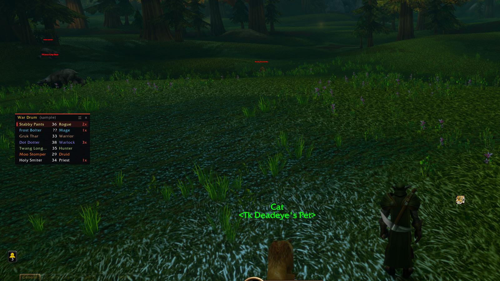

# War Drum

A small list of the enemy players who attack you, for **WoW Forever** (game version 1.60.x,
interface `16001`).

Each row is one player: **name in class color, level, class, and how often they killed you.**
When someone on the list comes back into view, a war drum sounds.

## Beta
0.9 is a beta. The rules for who gets listed are tested outside the game and the addon has run
cleanly in ordinary play, but it is young and has seen few real ganks. If someone is listed who
shouldn't be, or an attacker is missing, type `/wd dump` right after the fight, then `/reload`,
and send the `WarDrumDB.log` part of `WTF\Account\<you>\SavedVariables\WarDrum.lua` with a
line on what happened: https://github.com/deusvx/WarDrum/issues

## What it does
- **Lists your attackers by itself.** An enemy player who has you targeted in a fight shows at
  once. After the fight the game's own damage meter settles it: whoever damaged you stays, even
  if you never saw them; whoever didn't is taken off again.
- **Counts their kills.** Die, and everyone who damaged you in that fight gets the kill.
  It counts your revenge too: the tooltip shows how often you killed them.
- **Warns you.** A chat line and a war drum when a listed player comes into view, at most once a
  minute each. The row lights up red while they are near.
- **Stays small.** 200 wide by default, as narrow as 160. Level and class columns can be
  switched off; the name is in the class color either way.
- **Options in a window of their own** (`/wd`, or the three bars on the list): width,
  size, background, rows, columns, lock, the warning and its sound. Point at a setting and the
  panel on the right says what it does.

## Who never counts
- **Your own faction.** A duel is not a gank.
- **Battlegrounds and arenas,** where everyone attacks you (a switch, on by default).
- **Players you attacked first** while they were not targeting you, even if they fight back
  and win.
- Pets, creatures, and anyone who only had you targeted without damaging you.

## Using it
| | |
|---|---|
| `/wd` | open the settings |
| `/wd show`, `/wd hide` | show or hide the list |
| `/wd demo` | show sample players, to place the list and set it up |
| `/wd remove Name` | take one player off (or Shift + right-click their row) |
| `/wd clear` | empty the list |
| `/wd reset` | move the list back to where it started |

Drag the list by its title or by a row. Scroll it with the mouse wheel when there are more
players than rows. Point at a row for the full story: attacks, kills, your kills, when and where
you last met.

**Keep enemy nameplates switched on.** The game only shows an addon the players whose nameplate
is on screen, or who you target or point at. That is what the warning and the level column rely
on. Players named only by the damage meter are listed without a level until you see them.

## How it knows
WoW Forever gives addons no combat log, and hides a good deal during a fight. Two things are
readable: who an enemy player in view is and whether they are targeting you, and, once the fight
is over, the built-in damage meter's breakdown of the damage you took, by name. War Drum uses
the first to show attackers at once and the second to get it right.

It keeps a short record of what the game showed during those fights (`WarDrumDB.log` in the
saved variables), so a wrong call can be traced. `/wd dump` adds the damage meter's full view.

## Lightweight
- One file, no libraries. Asleep while no enemy player is around; twice a second while one is.
- The options window is only built when you open it.

## Installing
Get it from CurseForge, or copy the `WarDrum` folder into
`World of Warcraft\_forever_\Interface\AddOns\`.

## Tests
`tests/run_tests.sh` runs the addon outside the game against a small stand-in for it:
14 scenarios, from "an enemy merely in view is not an attack" to "what the game hides is never
touched". See `tests/README.md`.

## License
Copyright (c) 2026 Tk Deadeye. All rights reserved: free to download and use, not to
redistribute. See `LICENSE`.
